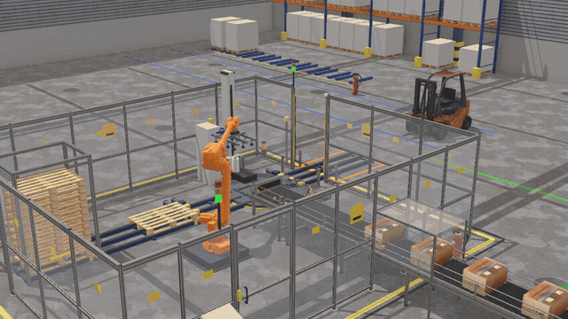
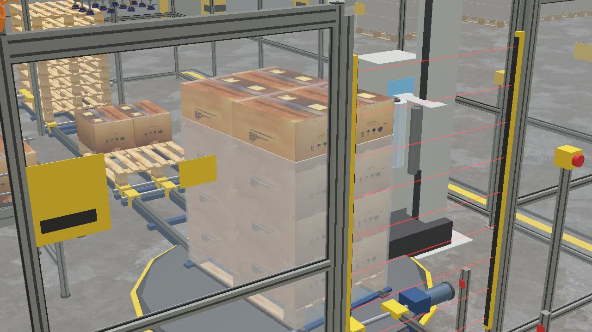

# Cellule de palettisation robotisée — Webots R2025a

Cellule installée dans un hangar logistique. Un robot palettiseur à ventouses prend les colis arrivant par convoyeur et les pose sur une palette Euro.
Un sas forme les lots. La palette pleine est banderolée, puis un chariot élévateur la prend et la dépose dans la zone de stockage du hangar.

**▶ [Animation 3D interactive dans le navigateur](https://nicolasbrochen.github.io/palletizer-cell-webots/)** (GitHub Pages, sans installer Webots) · [vidéo d'un cycle complet, accélérée ×4 (MP4)](docs/palettisation.mp4)

[](docs/palettisation.mp4)

| Prise d'un lot par le préhenseur à ventouses | Banderoleuse à plateau tournant |
|---|---|
| [](docs/prise_lot.mp4) | [](docs/banderolage.mp4) |

## Visualiser sans Webots

- **Animation 3D interactive** : [nicolasbrochen.github.io/palletizer-cell-webots](https://nicolasbrochen.github.io/palletizer-cell-webots/).
  C'est un export HTML5 de Webots d'un cycle complet (3 min 38 s simulées) : on peut tourner autour de la scène, zoomer
  et avancer dans le temps. Les fichiers sont dans [`site/`](site/), publiés sur GitHub Pages depuis la branche `gh-pages`
  (`git subtree push --prefix site origin gh-pages`).
- **Vidéos** : [`docs/`](docs/) contient le cycle complet et deux gros plans (prise d'un lot, banderolage).
- **Reconstruire** : `tools/build_site.sh` refait l'animation, et `tools/build_media.sh` refait les vidéos, le GIF et les images
  (il faut un affichage, car Webots fait le rendu des vidéos).

## Lancer dans Webots

```
webots worlds/palettisation.wbt
```

## Modèles

**Issus de la bibliothèque officielle Webots**

| Élément | PROTO |
|---|---|
| Robot | `Irb4600-40` (ABB IRB 4600/40, 6 axes, charge 40 kg). L'axe 4 est bloqué et l'outil reste vertical, comme sur un palettiseur |
| Palettes | `WoodenPallet` 1200×800×144 (palette Euro) et `WoodenPalletStack` pour le magasin |
| Colis | `CardboardBox` 400×600×300 (4 couches de 4 colis) |
| Chariot élévateur et piéton | `Forklift`, `Pedestrian` |
| Matériaux | `RoughConcrete`, `CorrugatedMetal`, `GalvanizedMetal`, `Rubber` |

**Construits pour ce projet**

Aucun modèle libre et exploitable n'existe pour ces équipements : ce qu'on trouve en ligne est payant ou sous licence restreinte.
Ils sont donc modélisés de façon détaillée dans `tools/gen_world.py` et `protos/`.

| Élément | Construction |
|---|---|
| **Carter de protection** (`protos/GuardBay.proto`) | Repris des projets *praline-cell* et *robot-cell-webots* (`SafetyFence.proto`) : profilés alu 45×45 rainurés, polycarbonate clair, joints noirs, lisse basse et lisse intermédiaire, double lisse haute, platines au sol, hauteur 2,2 m |
| **Préhenseur à ventouses** | Bride ISO 9409, changeur d'outil, poutre en profilé 45×90 et 3 poutres porte-ventouses. 12 ventouses à soufflet 1,5 pli (lèvre bleue) sur compensateurs de niveau. Éjecteur de vide avec silencieux, vacuostat, tuyaux PU, capteur de présence produit. Surface 640×840 mm pour un lot de 2 colis |
| **Convoyeurs à bande** | Châssis en profilés alu, bande caoutchouc animée, tambours, retour de bande, pieds réglables, guides inox réglables, motoréducteur, cellules et réflecteurs |
| **Fermeuse de cartons** | Machine amont, d'où sortent les colis |
| **Ligne palettes** | Convoyeurs à chaînes bas (3 brins sous les semelles, chaînes à 0,10 m). Le chariot prend la palette en passant les fourches entre les brins. Motoréducteurs et carters de pignons |
| **Banderoleuse automatique à plateau tournant** | Plateau de Ø 2 m avec convoyeur à chaînes intégré, mât de 2,6 m (charge 1,44 m de haut), chariot porte-bobine avec pré-étirage, armoire et pupitre. Le plateau fait tourner la palette pendant que le chariot monte |
| **Hangar** | Bardage, soubassement béton, poteaux de charpente protégés, fermes et luminaires suspendus, portes de quai, racks à palettes (bleu et orange) chargés, zone de stockage au sol sur longrines, allées marquées |

La géométrie statique est fusionnée par matériau en `IndexedFaceSet`, pour garder la simulation proche du temps réel.

## Déroulement du cycle

1. **Arrivée des colis** : la cellule **B1** annonce chaque colis à l'entrée du convoyeur.
   **B5** surveille l'accumulation ; si elle est pleine, l'arrivée des colis s'arrête.
2. **Sas de formation des lots** : **B2** compte les colis qui entrent dans le sas. Au 2ᵉ colis, la butée
   d'entrée (vérin) se lève. **B3** et **B4** confirment que le lot est complet contre la butée fixe.
3. **Robot** : l'automate envoie l'ordre `pick_place`. Le robot descend en mouvement linéaire, fait le vide,
   remonte puis transfère le lot (interpolation articulaire). Il le dépose sur la demi-palette nord, puis sud, couche par couche.
   Le sas se rouvre dès que le lot est prélevé.
4. **Palette pleine** (8 lots) : transfert par chaînes vers la **banderoleuse à plateau tournant**.
   Le plateau tourne à 12 tr/min : tours de pied, montée du chariot, tours de tête, puis arrêt indexé pour réaligner les chaînes.
5. **Évacuation** : la palette sort par la barrière immatérielle **LC1**. Le **muting** est activé par la séquence M1 puis M2.
   Elle arrive au poste P3, hors du grillage.
6. **Chariot élévateur** : il entre les fourches dans les passages de la palette, la lève de 3 cm, recule,
   puis rejoint l'allée vers la zone de stockage du hangar. Il la dépose sur des longrines (stockage au sol) et revient en attente.
   Quand le hangar est plein, la palette la plus ancienne est expédiée.

## Capteurs

| Repère | Type | Rôle |
|---|---|---|
| B1 | Cellule photo-électrique | Annonce d'un colis en entrée de convoyeur |
| B5 | Cellule | Accumulation pleine sur le convoyeur d'entrée |
| B2 | Cellule | Comptage des colis qui entrent dans le sas |
| B3, B4 | Cellules | Lot complet en butée (colis 1 et colis 2) |
| S_P0…S_P3 | Cellules | Présence de palette au magasin, à la palettisation, à la banderoleuse et à l'évacuation |
| Capteur préhenseur | Capteur de proximité | Présence d'un colis sous les ventouses |

## Sécurités

| Dispositif | Norme de référence | Effet |
|---|---|---|
| Carter périmétrique de 2,2 m (profilés alu + polycarbonate), garde au sol de 0,12 m | ISO 14120 / ISO 13857 | Protection fixe |
| Tunnel en polycarbonate sur l'entrée du convoyeur | ISO 13857 | Empêche d'atteindre le robot par l'ouverture du convoyeur |
| Porte d'accès avec interrupteur à interverrouillage (LED) | ISO 14119 | Ouverture → arrêt du robot, des convoyeurs et de la banderoleuse ; réarmement manuel obligatoire |
| **LC1** : barrière immatérielle de sortie (9 faisceaux) + muting M1/M2 + lampe de muting | IEC 61496 / IEC 62046 | Laisse passer la palette, mais coupe tout si une personne la franchit |
| **LC2** : barrière immatérielle côté réapprovisionnement des palettes vides | IEC 61496 | Franchissement → arrêt de sécurité |
| 2 scrutateurs laser (côtés est et ouest de la zone d'évacuation) | IEC 61496-3 | Présence détectée → transfert de sortie et prise par le chariot suspendus ; reprise automatique 2 s après le dégagement |
| Détection de piéton embarquée sur le chariot | — | Ralenti sous 6 m, arrêt sous 3,5 m |
| Arrêts d'urgence (pupitre, sortie, convoyeur, banderoleuse) | ISO 13850 | Arrêt et défaut mémorisé |
| Colonnes lumineuses (vert = auto, orange = muting, intrusion ou arrêt fin de cycle, rouge = défaut) | IEC 60204-1 | Signalisation |
| Marquage au sol : zone de danger jaune et noire, allée chariots bleue, allée piétons verte | ISO 7010 | |

Arrêt de sécurité : le robot passe en **arrêt de catégorie 2** (il garde sa position, asservi).
Les convoyeurs, transferts et la banderoleuse s'arrêtent. Le défaut reste mémorisé jusqu'au **réarmement R**,
qui est refusé tant que la cause est présente.

## Commandes clavier (cliquer d'abord dans la vue 3D)

| Touche | Action |
|---|---|
| `E` | Arrêt d'urgence (enfoncer / déverrouiller) |
| `D` | Ouvrir / fermer la porte d'accès |
| `R` | Réarmement |
| `P` | Faire entrer / sortir un piéton : il traverse l'allée du chariot, passe devant les scrutateurs et franchit LC1 |
| `S` | Arrêt fin de cycle / redémarrage |

On peut aussi envoyer ces commandes par script : écrire la lettre (par exemple `R`) dans le champ `customData` du robot « automate cellule ».
Le chariot élévateur, qui travaille hors de la cellule, n'est pas arrêté par un défaut de la cellule : il est protégé par sa propre détection de piétons.

L'état de la cellule s'affiche en surimpression et sur l'écran du pupitre (Display « IHM »).

## Architecture logicielle

```
controllers/
  cell_plc/cell_plc.py                 automate de cellule (superviseur)
      ├─ partie COMMANDE : décisions prises uniquement à partir des capteurs Webots
      └─ partie OPÉRATIVE simulée : bandes, butée, chaînes palettes, plateau de banderolage, chariot
  palletizer_robot/palletizer_robot.py contrôleur du robot (trajectoires, vide/ventouses)
  palletizer_robot/irb4600_kin.py      IK analytique de l'IRB 4600, outil vertical, sans dépendance
  animation_recorder/, media_recorder/  enregistreurs (animation HTML5, vidéos du README)
tools/gen_world.py                     génère worlds/palettisation.wbt (implantation paramétrée)
tools/build_site.sh                    animation 3D HTML5 -> site/ (GitHub Pages)
tools/build_media.sh                   vidéos, GIF et images -> docs/
```

L'automate et le robot communiquent en JSON via Emitter/Receiver (canaux 1 et 2).

Pour modifier l'implantation, éditer `tools/gen_world.py`, puis lancer `python3 tools/gen_world.py`. Le carter se règle travée par travée avec `protos/GuardBay.proto`.

## Simplifications

- Les colis, palettes et le chariot sont déplacés de façon cinématique par le superviseur, sans physique de contact.
  C'est un choix de robustesse : la cellule se comporte de façon déterministe.
  Le robot, lui, est piloté par ses vrais moteurs, en suivant la trajectoire calculée.
- La prise par ventouses est simulée : quand le vide est établi, les colis sont solidaires du TCP.
- Les scrutateurs laser sont représentés par des éventails de 31 faisceaux de distance, sans lidar à rendu GPU,
  pour garder le temps réel.
- La détection de piéton du chariot se fait avec la position connue par le superviseur, à la manière d'un système à étiquettes UWB.
