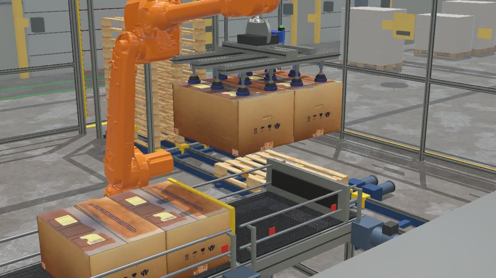

**English** · [Français](README.fr.md)

# Robotic palletizing cell — Webots R2025a

A palletizing cell inside a logistics warehouse. A vacuum-gripper robot picks the cases arriving on a conveyor and stacks
them on a Euro pallet. A buffer forms the lots. The full pallet is stretch-wrapped, then a forklift picks it up and drops it
in the warehouse storage area.

**▶ [Interactive 3D animation in the browser](https://nicolasbrochen.github.io/palletizer-cell-webots/)** (GitHub Pages, no Webots needed) · [video of one full cycle, 4× speed (MP4)](docs/palettisation.mp4)

[](docs/palettisation.mp4)

| A lot picked by the vacuum gripper | Turntable stretch wrapper |
|---|---|
| [](docs/prise_lot.mp4) | [](docs/banderolage.mp4) |

## Viewing without Webots

- **Interactive 3D animation**: [nicolasbrochen.github.io/palletizer-cell-webots](https://nicolasbrochen.github.io/palletizer-cell-webots/).
  It is a Webots HTML5 export of one full cycle (3 min 38 s of simulated time): you can orbit the scene, zoom and scrub
  the timeline. The files live in [`site/`](site/) and are published on GitHub Pages from the `gh-pages` branch
  (`git subtree push --prefix site origin gh-pages`).
- **Videos**: [`docs/`](docs/) holds the full cycle and two close-ups (lot pick, wrapping).
- **Rebuilding**: `tools/build_site.sh` rebuilds the animation, and `tools/build_media.sh` rebuilds the videos, GIF and
  stills (a display is required, because Webots renders the videos).
  Under WSL, both scripts automatically use **Webots for Windows** when it is installed together with a Windows Python
  (`winget install -e --id Python.Python.3.12`). Rendering then goes straight to the GPU, without the WSLg layer:
  on a machine with an NVIDIA GPU, a 45 s simulated test went from 26 s to 11 s, and the animation build from about
  10 min to 40 s. The project is copied to `%LOCALAPPDATA%\Temp\palettiseur-build`. `WEBOTS_MODE=linux` forces the
  Linux Webots (see [`tools/webots_env.sh`](tools/webots_env.sh)). Keep the Webots window visible while the videos
  record: Windows loses the capture when the window is covered, and the script stops on black frames.

## Running in Webots

```
webots worlds/palettisation.wbt
```

## Models

**From the official Webots library**

| Item | PROTO |
|---|---|
| Robot | `Irb4600-40` (ABB IRB 4600/40, 6 axes, 40 kg payload). Axis 4 is locked and the tool stays vertical, like a palletizer |
| Pallets | `WoodenPallet` 1200×800×144 (Euro pallet) and `WoodenPalletStack` for the magazine |
| Cases | `CardboardBox` 400×600×300 (4 layers of 4 cases) |
| Forklift and pedestrian | `Forklift`, `Pedestrian` |
| Materials | `RoughConcrete`, `CorrugatedMetal`, `GalvanizedMetal`, `Rubber` |

**Built for this project**

No free, usable model exists for this equipment: what can be found online is paid or under a restrictive license.
They are modelled in detail in `tools/gen_world.py` and `protos/`.

| Item | Construction |
|---|---|
| **Safety guarding** (`protos/GuardBay.proto`) | Taken from the *praline-cell* and *robot-cell-webots* projects (`SafetyFence.proto`): 45×45 slotted aluminium profiles, clear polycarbonate, black seals, kick rail and middle rail, double top rail, floor plates, 2.2 m high |
| **Vacuum gripper** | ISO 9409 flange, tool changer, 45×90 profile beam and 3 cup-carrying beams. 12 bellows suction cups (1.5 folds, blue lip) on level compensators. Vacuum ejector with silencer, vacuum switch, PU hoses, product presence sensor. 640×840 mm footprint for a lot of 2 cases |
| **Belt conveyors** | Aluminium-profile frame, animated rubber belt, drums, belt return, adjustable feet, adjustable stainless guides, gearmotor, photocells and reflectors |
| **Case sealer** | Upstream machine the cases come out of |
| **Pallet line** | Low chain conveyors (3 strands under the bottom boards, chains at 0.10 m). The forklift picks the pallet by sliding its forks between the strands. Gearmotors and sprocket guards |
| **Automatic turntable stretch wrapper** | Ø 2 m turntable with a built-in chain conveyor, 2.6 m mast (load 1.44 m high), film carriage with pre-stretch, cabinet and operator panel. The turntable spins the pallet while the carriage rises |
| **Warehouse** | Cladding, concrete base wall, protected building columns, roof trusses and hanging lights, dock doors, loaded pallet racks (blue and orange), floor storage on rails, marked aisles |

Static geometry is merged per material into `IndexedFaceSet` nodes, to keep the simulation close to real time.

## Cycle

1. **Case infeed**: photocell **B1** announces each case at the conveyor infeed.
   **B5** watches the accumulation; when it is full, the case supply stops.
2. **Lot-forming buffer**: **B2** counts the cases entering the buffer. On the 2nd case, the infeed stop (pneumatic
   cylinder) rises. **B3** and **B4** confirm that the lot is complete against the fixed end stop.
3. **Robot**: the PLC sends the `pick_place` order. The robot moves down linearly, makes the vacuum, lifts, then carries
   the lot (joint interpolation). It places it on the north half-pallet, then the south one, layer by layer.
   The buffer reopens as soon as the lot is picked.
4. **Full pallet** (8 lots): chain transfer to the **turntable stretch wrapper**.
   The turntable spins at 12 rpm: bottom wraps, carriage rise, top wraps, then an indexed stop that realigns the chains.
5. **Exit**: the pallet leaves through light curtain **LC1**. **Muting** is triggered by the M1 then M2 sequence.
   It reaches station P3, outside the guarding.
6. **Forklift**: it slides its forks into the pallet openings, lifts it by 3 cm, backs out, then follows the aisle to the
   warehouse storage area. It drops it on floor rails and returns to its waiting position.
   When storage is full, the oldest pallet is shipped.

## Sensors

| Tag | Type | Role |
|---|---|---|
| B1 | Photoelectric cell | Case announced at conveyor infeed |
| B5 | Photocell | Infeed conveyor accumulation full |
| B2 | Photocell | Counts the cases entering the buffer |
| B3, B4 | Photocells | Lot complete against the stop (case 1 and case 2) |
| S_P0…S_P3 | Photocells | Pallet present at the magazine, palletizing station, wrapper and exit |
| Gripper sensor | Proximity sensor | Case present under the suction cups |

## Safety

| Device | Reference standard | Effect |
|---|---|---|
| 2.2 m perimeter guarding (aluminium profiles + polycarbonate), 0.12 m floor gap | ISO 14120 / ISO 13857 | Fixed guard |
| Polycarbonate tunnel over the conveyor infeed | ISO 13857 | Prevents reaching the robot through the conveyor opening |
| Access door with interlock switch (LED) | ISO 14119 | Opening → robot, conveyors and wrapper stop; manual reset required |
| **LC1**: exit light curtain (9 beams) + M1/M2 muting + muting lamp | IEC 61496 / IEC 62046 | Lets the pallet through, but stops everything if a person crosses it |
| **LC2**: light curtain on the empty-pallet supply side | IEC 61496 | Crossing → safety stop |
| 2 laser scanners (east and west sides of the exit zone) | IEC 61496-3 | Person detected → exit transfer and forklift pick suspended; automatic restart 2 s after the zone clears |
| Pedestrian detection on the forklift | — | Slows below 6 m, stops below 3.5 m |
| Emergency stops (panel, exit, conveyor, wrapper) | ISO 13850 | Stop and latched fault |
| Stack lights (green = auto, orange = muting, intrusion or end-of-cycle stop, red = fault) | IEC 60204-1 | Signalling |
| Floor marking: yellow and black danger zone, blue forklift aisle, green pedestrian aisle | ISO 7010 | |

Safety stop: the robot goes into a **category 2 stop** (it holds its position, under servo control).
Conveyors, transfers and the wrapper stop. The fault stays latched until the **R reset**, which is refused while the
cause is still present.

## Keyboard commands (click in the 3D view first)

| Key | Action |
|---|---|
| `E` | Emergency stop (press / release) |
| `D` | Open / close the access door |
| `R` | Reset |
| `P` | Send a pedestrian in / out: they cross the forklift aisle, pass in front of the scanners and cross LC1 |
| `S` | End-of-cycle stop / restart |

These commands can also be sent by script: write the letter (for example `R`) into the `customData` field of the
"automate cellule" robot.
The forklift, which works outside the cell, is not stopped by a cell fault: it is protected by its own pedestrian
detection.

The 3D view overlays only the PLC's **last two events** (in yellow, in English).
The detailed cell status is shown on the operator panel screen (Display "IHM").

## Software architecture

```
controllers/
  cell_plc/cell_plc.py                 cell PLC (supervisor)
      ├─ CONTROL part: decisions taken only from the Webots sensors
      └─ simulated PLANT part: belts, stop, pallet chains, wrapper turntable, forklift
  palletizer_robot/palletizer_robot.py robot controller (trajectories, vacuum/suction cups)
  palletizer_robot/irb4600_kin.py      analytical IRB 4600 IK, vertical tool, no dependency
  animation_recorder/, media_recorder/  recorders (HTML5 animation, README videos)
tools/gen_world.py                     generates worlds/palettisation.wbt (parametric layout)
tools/build_site.sh                    HTML5 3D animation -> site/ (GitHub Pages)
tools/build_media.sh                   videos, GIF and stills -> docs/
tools/webots_env.sh                    Webots selection (Windows under WSL, else Linux)
```

The PLC and the robot exchange JSON messages through Emitter/Receiver (channels 1 and 2).

To change the layout, edit `tools/gen_world.py`, then run `python3 tools/gen_world.py`. The guarding is set bay by bay
with `protos/GuardBay.proto`.

## Simplifications

- Cases, pallets and the forklift are moved kinematically by the supervisor, without contact physics.
  This is a robustness choice: the cell behaves deterministically.
  The robot itself is driven by its real motors, following the computed trajectory.
- Vacuum gripping is simulated: once the vacuum is established, the cases are attached to the TCP.
- The laser scanners are modelled as fans of 31 distance beams, without a GPU-rendered lidar, to keep real time.
- The forklift's pedestrian detection uses the position known to the supervisor, like a UWB tag system.
